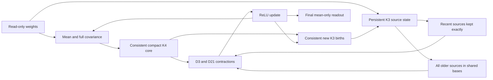

# Phase 2: competition, architecture and validation audit

> **Subsequent worker review:** this is the earlier research synthesis. [WORKER_REVIEW_2026-09-10](WORKER_REVIEW_2026-09-10.md) and [CURRENT_STATE](CURRENT_STATE.md) supersede its execution status. Samuel subsequently instructed us to hold eligibility work off entirely; the organizer-question task below is inactive. The earlier documentation ACCEPT does not apply to the worker's later instrument/math changes, which received two REJECT verdicts.

**September 10, 2026. Research and implementation planning; no new estimator experiment, promotion, submission, designation, seed claim or vault evaluation.**

Independent fresh-context Skeptic: **ACCEPT for this documentation package**, after correcting historical line references and adding an explicit derivative-eligibility checkpoint. Acceptance does not establish a winning method, candidate certification or submission eligibility. [Review record](../experiments/2026-09-10_validation_audit/skeptic_verdict.md).

## Decision

We have the right mathematical starting point, but have **not** identified or implemented a demonstrated winning architecture. The current exact-transport SIMPLE-K3 chain preserves valuable cross-neuron history; it spends too much carrying that history and omits useful fourth-order structure. The most concrete next step is to reconstruct a newly public compact, full-history K3 architecture with a consistent cheap K4 closure, then improve its remaining bottleneck. Another broad rewrite, another scalar readout fit, or simply increasing Strassen depth is not the best first investment.

The public evidence does not show how the leaders work. It does show that the old claim that all affordable score improvements are exhausted is untenable. Team 504aldo's September 9–10 release provides equations, code and submitted results for mechanisms our failed interventions did not test. It is a credible catch-up reference, **not** a winning result or an independently reproduced benchmark. [Public implementation](https://github.com/504aldo/whest-p2-cumulant-k3/tree/18c17e2d7a9aeacd399cfc2c6b571e4e16dbfb45), [technical discussion](https://discourse.aicrowd.com/t/everything-we-tried-a-factorized-k-3-cumulant-propagation-estimator-at-0-25-x-b-where-its-flops-go-and-25-measured-dead-ends-team-504aldo-rank-10/18218).

Our evaluator has strong network-generation, scoring and operation-accounting foundations. It cannot reproduce hidden labels or server timing exactly. Specific memory-proof, lifecycle, pairing and data-access gaps should be repaired before trusting a new near-frontier promotion. The right restructuring is a clearer reference/candidate boundary and one authoritative current plan, rather than replacement of the working numerical infrastructure.

This synthesis combines three independent repo/literature audits and direct browsing in Samuel's Chrome. Detailed evidence lives in:

- [Competition source ledger and current board](research/2026-09-10_competition_sources.md).
- [Architecture audit, with source and raw-artifact references](research/2026-09-10_architecture_audit.md).
- [Primary literature and pinned public-code review](research/2026-09-10_literature_review.md).
- [Validation audit and executed-check record](research/2026-09-10_validation_audit.md).
- [Current implementation plan](GAME_PLAN.md).

## 1. The actual competition we must win

Phase 2 opened August 22, with the launch post on August 23. It is already running at 1024 neurons per layer and 16 layers. Networks have He-Gaussian weights, no biases and ReLU activations; inputs follow a standard multivariate Gaussian. We must return all post-ReLU means, but the score uses final-layer squared error. [Official overview](https://www.aicrowd.com/challenges/arc-white-box-estimation-challenge-2026), [launch announcement](https://discourse.aicrowd.com/t/phase-2-of-the-arc-white-box-estimation-challenge-is-live/18197).

For each feasible network, with final error `e_i` and counted FLOPs `F_i`,

```text
B = 2^41
q_i = max(0.1, F_i / B)
competition score = mean_i(q_i × e_i)
```

Compute the product per network before averaging. The multiplier does not fall below 0.1. More accuracy at excessive cost can lose to a cheaper estimator; savings below the floor provide deployment headroom but no further direct discount. Phase-2 lambda is zero. Residual runtime is a failure cliff, not another weighted score term. Exceeding a hard limit fails the prediction; the zero-output error and absence of a discount can overwhelm small gains on successful networks. [Rules v14](https://www.aicrowd.com/challenges/arc-white-box-estimation-challenge-2026/challenge_rules), [resources](https://www.aicrowd.com/challenges/arc-white-box-estimation-challenge-2026/dynamic_contents).

Current official caps are **400 ms residual, 120 s wall, 5 s import/setup**, and participant memory described as **8 GB** on the website. The installed grader uses **8192 MiB**. The participant gets one physical core/two vCPU; the backend gets seven physical cores/fourteen vCPU on a 64-GB CPU-only host. Network access is unavailable. This replaces the older documentation premise that 120 seconds was merely an installed default and only observed successful times were public authority. It does not make local wall seconds transferable. [Rules §5.6](https://www.aicrowd.com/challenges/arc-white-box-estimation-challenge-2026/challenge_rules).

The public downloadable dataset has **1,100 networks: mini 100 and full 1,000**, with one-billion-sample reference means. The live submission page exposes a different **50-public/50-sealed** evaluation partition. Final prize evaluation is a **fresh private rerun** of up to two designated valid submissions, with reference precision and additional comparison networks at organizer discretion. Those three populations must never be conflated. Fresh local mints estimate the target distribution; they cannot reveal the realised hidden leaderboard or rerun score. [Resources](https://www.aicrowd.com/challenges/arc-white-box-estimation-challenge-2026/dynamic_contents), [submission UI](https://www.aicrowd.com/challenges/arc-white-box-estimation-challenge-2026/submissions/330566), [rules §6](https://www.aicrowd.com/challenges/arc-white-box-estimation-challenge-2026/challenge_rules).

**The nomination ambiguity is resolved.** Rules §6 permits up to two submissions and defaults to the best two valid public submissions if none are selected. Section **7**, rather than section 6 alone, says only the participant's best-scoring eligible submission is ranked. Do not average the two or impose a worst-of-two objective. A robust fallback can hedge a faster candidate's runtime risk; selecting such a pair remains Samuel's decision, subject to eligibility and the eventual selection deadline. No nomination was made here. [Rules §6–7](https://www.aicrowd.com/challenges/arc-white-box-estimation-challenge-2026/challenge_rules).

Planning dates: registration/team freeze **October 2**; submission deadline **October 17, 23:59 UTC**; write-up **October 24**; tentative winners **November 15**. The final selection interface/deadline is still to be announced. The ten-submissions-per-team daily limit resets on UTC days. Generic competition-period wording includes a later date, but the specific Phase-2 deadline is the relevant working deadline. [Official rules](https://www.aicrowd.com/challenges/arc-white-box-estimation-challenge-2026/challenge_rules).

## 2. Where we stand against the current frontier

These are visible public results on September 10, not private rerun rankings. **Noise floors for these official MSEs were not displayed and are unavailable.** Do not treat them as exact true-function errors or compare tiny differences to noise-corrected local estimates.

| Candidate | Public adjusted mean | Public raw final MSE | Budget fraction | Assessment |
|---|---:|---:|---:|---|
| Leader, marius_binner #330500 | 2.683e-9 | 1.700e-8 | 0.1578 | Best detailed row inspected; method undisclosed |
| Public 504aldo V29 #330093 | 5.40e-9 | 2.13e-8 | 0.2526 | Source released; reported mechanism is inspectable |
| Our best public #330290, Strassen L4 | 1.836e-8 | 3.779e-8 | 0.4858 | Rank 44; limited observed wall margin |
| Our new #330566, Strassen L2 | 2.284e-8 | 3.779e-8 | 0.6042 | Graded successfully; materially larger observed wall margin |

Sources: [leader detail](https://www.aicrowd.com/challenges/arc-white-box-estimation-challenge-2026/submissions/330500), [public architecture](https://github.com/504aldo/whest-p2-cumulant-k3), [our L4](https://www.aicrowd.com/challenges/arc-white-box-estimation-challenge-2026/submissions/330290), [our L2](https://www.aicrowd.com/challenges/arc-white-box-estimation-challenge-2026/submissions/330566). The leaderboard's rounded leader row was 2.70e-9; the newer detailed row above avoids combining mismatched fields.

The descriptive gap is **6.84×** for our best public submission and **8.51×** for the safer L2. The leader is about 2.22× more accurate and uses about 3.08× less compute than our L4. These ratios describe displayed means; they have no authority as paired statistical promotion evidence. Both accuracy and representation cost matter. Matching 504aldo would recover a substantial part of the gap but leave another roughly 2× in score.

At the leader's displayed 2.683e-9 target, the following raw-error ceilings would tie, assuming a constant feasible multiplier:

| Budget multiplier | Raw MSE required to tie |
|---:|---:|
| 0.10 | 2.683e-8 |
| 0.15 | 1.789e-8 |
| 0.20 | 1.342e-8 |
| 0.25 | 1.073e-8 |
| 0.6042 | 4.440e-9 |

These are planning identities, not proposed gates, forecasts, or physical noise floors. At 2.13e-8 raw, a method needs a multiplier below roughly **0.126** to beat that target. This makes the next research question concrete: preserve most of the compact chain's accuracy while eliminating a large fraction of its remaining cost, or add enough accurate missing state to justify a higher cost. A lower operation count alone is insufficient.

The L2 row now verifies the earlier public-mean score and raw-error predictions at the UI's precision: raw 3.779e-8 lies in [3.760e-8, 3.798e-8], adjusted 2.284e-8 lies in [2.26e-8, 2.30e-8]. Its 100 visible wall entries range from 29.9598 to **33.0009 seconds**, inside the predicted [26,45] seconds. The public subset has zero failures, and all 100 visible statuses are completed; private accuracy remains sealed. This is partial prediction resolution on the exposed quantities, not revelation of a full hidden-suite mean. [L2 result](https://www.aicrowd.com/challenges/arc-white-box-estimation-challenge-2026/submissions/330566).

The observed cap/worst-wall ratio is **3.64×** for L2 versus **1.05×** for L4, whose worst displayed time is **114.6798 seconds**. Those are server observations, distinct from the earlier contention-adjusted planning margins. L2 is a credible fallback, not a future-runtime guarantee. The operation prediction was already missed (9,321 actual versus 9,304 predicted); residual ≤0.15 seconds was not visible and remains unverified here. The two historical certification gate failures remain failures; successful grading does not retroactively rewrite the contract. [L4 telemetry](https://www.aicrowd.com/challenges/arc-white-box-estimation-challenge-2026/submissions/330290), [repository evidence](../experiments/2026-09-10_slice5/certify_k3_strassen_L2.json).

## 3. What the newest discussions change

### The public compact K3 release is the most actionable evidence

504aldo reports a progression from V16b at 2.22e-8 adjusted to V29 at 5.40e-9. Its K4 regeneration changes raw error from about 4.46e-8 to 2.26e-8; restoring thin D21 feedback improves it further; preserving older sources in shared bases then cuts transport cost; batching and Strassen reduce the final bill. These are author-reported ablations with repeated public fitting and no accompanying reference-noise floor. They identify plausible mechanisms to reproduce, not ready-made independent evidence for our promotion. [Release and measured dead ends](https://discourse.aicrowd.com/t/everything-we-tried-a-factorized-k-3-cumulant-propagation-estimator-at-0-25-x-b-where-its-flops-go-and-25-measured-dead-ends-team-504aldo-rank-10/18218).

The release does **not** establish that leaders use the same representation, that every old tensor method is impossible, or that a specific raw-error cluster is a lower bound. Its own cost analysis makes older-source reconstruction a plausible bottleneck, but the leading method remains unknown. The useful information is the explicit state, algebra, and measured ablations.

### Runtime discussions require reading the later corrections

The residual-cap thread initially discusses local/server differences and operation overhead. A later correction identifies 166 scalar synchronization points: removing those changes failures despite a similar named-operation count. Another large-payload failure remains undiagnosed. This supports avoiding frequent scalar extraction and tracking payload/call structure as well as FLOPs, but does not justify any universal per-operation runtime guarantee. The current graded configuration is WhestBench 0.16.1 and flopscope 0.12.1, newer than the organizer's August 27 reply. [Residual discussion](https://discourse.aicrowd.com/t/shipped-covariance-propagation-example-trips-the-phase-2-residual-cap-locally-0-16-0-but-grades-fine-what-happens-when-the-evaluator-upgrades/18202), [current configuration](https://www.aicrowd.com/challenges/arc-white-box-estimation-challenge-2026/submissions/330566).

The September 9 information-leak thread received an organizer acknowledgment and planned fix. We did not inspect the leaked screenshot or use error messages to infer competitors' methods. It is relevant as a platform issue, not a source of algorithmic intelligence. [Organizer response](https://discourse.aicrowd.com/t/errors-are-leaking-information/18217).

### Recent weaker methods clarify why small refinements are insufficient

The zero-fitted-constants write-up distinguishes accurate one-step corrections from accumulated propagation drift. The exact-bivariate-covariance write-up shows that better Gaussian integrals do not recover discarded higher-order state, and that feeding a fitted readout back into propagation can hurt badly. The covariance/MC blend demonstrates useful residual complementarity at a much weaker baseline. These are helpful scope checks, not evidence to repeat those lanes at frontier precision. [No-fit analysis](https://discourse.aicrowd.com/t/phase-2-write-up-zero-fitted-constants-measured-what-the-64-calibration-numbers-in-a-relu-mlp-mean-propagator-are-actually-absorbing-submission-330001/18216), [exact covariance](https://discourse.aicrowd.com/t/phase-2-write-up-exact-bivariate-relu-covariance-plus-per-layer-calibration-3x-over-the-kit-baseline-with-negative-results-submission-329951/18214), [hybrid](https://discourse.aicrowd.com/t/phase-2-write-up-complementary-errors-beat-either-branch-a-fixed-0-75-0-25-covariance-whitened-antithetic-mc-blend-submission-328274/18200).

The public covariance baseline's error distribution is less heavy-tailed in Phase 2 than Phase 1. That makes local-to-public transfer less surprising for that method, but the thread's claim of universal 1:1 prediction overreaches its evidence. We still need fresh, paired, candidate-specific tests and runtime uncertainty. [Full-split distribution discussion](https://discourse.aicrowd.com/t/unusually-easy-leaderboard-set-effect-is-gone/18199).

## 4. The target architecture and why it differs from what we tested



The important word is **persistent**: information from older layers survives in cheaper coordinates. We should not return to a memoryless pair of K3 slices, a short generation window, or the dominant covariance eigenspace and call it the same method. D3 and D21 are the particular third-order summaries consumed at the next nonlinearity; after a dense mixing step those summaries alone do not contain enough information to reconstruct their successors.

The proposed state has five pieces:

1. Mean and full covariance, already trusted here.
2. A recent, accurately represented K3 source block and two shared transported leg families.
3. All older generations retained approximately in a shared weighted source-leg basis, optionally a nested older tier.
4. One explicit cheap fourth-order core whose update, read slices and induced K3 births are derived consistently.
5. A readout that avoids constructing state the final mean will never consume.

In the public source, a third dense leg can be expressed as `M = P diag(s) + 3 A diag(e) + Z Lᵀ`. This allows related D21 contractions to share products. The published **7→4** description is an algebraic statement conditional on its chosen representation: residual truncation, omitted terms and data-selected pruning are additional approximations. First recover the identity with a dense residual and an explicitly fixed term set; only then measure what each approximation loses. [Pinned V16b](https://github.com/504aldo/whest-p2-cumulant-k3/blob/18c17e2d7a9aeacd399cfc2c6b571e4e16dbfb45/estimators/estimator_v16b.py).

The compact K4 core uses `G = diag(g) + lambda C_off`. The important feature is not merely a scalar coefficient. The **same state feeds its transported diagonal, nonlinear use, and new K3 births**. Our T1 deletions changed blocks that K4's own update consumed; they were not an isolated test of this jointly derived replacement. The public author fitted coefficients on eight public networks. Our implementation must derive or refit coefficients on fresh design networks, and document prior exposure to the public structural choices. [Pinned K4 generator](https://github.com/504aldo/whest-p2-cumulant-k3/blob/18c17e2d7a9aeacd399cfc2c6b571e4e16dbfb45/generators/make_v17.py).

The old-source basis is built from actual weighted carried legs. That differs from selecting leading covariance modes or dropping old sources. It preserves right-side source coordinates and lets contractions combine in a smaller left-coordinate space. Rank 384 after age four and nested rank 224 after age seven are published empirical settings, not universal truths or our approved constants. [Derivation map](https://github.com/504aldo/whest-p2-cumulant-k3/blob/18c17e2d7a9aeacd399cfc2c6b571e4e16dbfb45/docs/derivation_code_map.md).

Deployment is a separate layer: legal immutable operations, batching, controlled Strassen, live-shape memory and cold/warm lifecycle checks. The public implementation uses extensive output buffers. Native flopscope accepting `out=` does not prove the participant proxy supports the same buffer semantics; it also does not amend our immutable-array contract. Investigate exact official semantics before proposing that route, or retain a functional implementation. No external source was executed or submitted in this audit.

**Eligibility needs an explicit checkpoint.** Rules §6 says a submission “is not derived from another Participant’s submission,” while other provisions permit attributed public resources. MIT licensing does not resolve this competition restriction. The compact-code reconstruction is therefore an attributed research reference until an eligibility basis is established. Obtain written organizer clarification before advancing a participant-derived reconstruction toward submission; a mathematical rewrite, fresh fitting or different code spelling does not automatically make it permissible. Document provenance for any separately developed candidate as well. A neutral clarification draft is included in the source ledger; it has not been posted. [Rules §4–6](https://www.aicrowd.com/challenges/arc-white-box-estimation-challenge-2026/challenge_rules).

### What our negative results actually close

| Existing evidence | Supported conclusion | Unsupported extension to avoid |
|---|---|---|
| T1 partial AUGMENT deletions | Those coupled partial term sets perform poorly | No affordable coherent K4 closure exists |
| T2 smooth readout, corrected controls and ridge | The tested feature/function family provides too little gain | Every in-flight relational correction has been tested |
| Packed/symmetric-operand feasibility | Almost no discount is available from those operands in that spelling | Every algebraic representation costs at least 0.5 B |
| Three-generation carry and selector work | Those finite-horizon and selection mechanisms lose too much useful information | All-age shared-coordinate compression is impossible |
| Broken adjoint intervention, later retracted | That instrument cannot settle the intended hypothesis | A proved adjoint impossibility or a reason to rerun the broken probe |

The repo's LOG already retracts the broad score-lane closure, while the old CURRENT_STATE headline and strategy packet repeat it. P08 was read three times during instrument repair; it remains spent. The in-flight sensitivity arm was never implemented. These facts warrant clearer documentation, not rescue of the failed T2 effect or retroactive alteration of any gate. Exact references and raw paths are in the [architecture audit](research/2026-09-10_architecture_audit.md).

## 5. Evidence-backed ideas beyond the public baseline

The closest foundational paper remains Wu et al.'s 2026 cumulant/Hermite work. Its theorem concerns fixed depth and polynomial activations; ReLU performance is empirical. Gaussian covariance theory and finite-width cumulant theory supply useful subexpressions but do not identify the fixed-network conditional expectation by ensemble averages alone. Current ARC upstream remains the August 4 commit already pinned locally; no new upstream solution was found. [Wu et al.](https://arxiv.org/abs/2605.05179), [Gaussian propagation](https://proceedings.mlr.press/v238/wright24a.html), [finite-width cumulants](https://jmlr.org/papers/v25/23-0643.html), [ARC implementation](https://github.com/alignment-research-center/mlp_cumulant_propagation/tree/93d091a4c26c042bfffa28f2e76a81bc0aba94bb).

“Novel” below means a concrete proposed application beyond the inspected implementations. It is not a claim of global priority, a proven improvement, or knowledge of a private entrant's algorithm. Each starts with a label-free feasibility question and a complete cost model. Detailed derivations, source limitations and falsifiers are in the [literature review](research/2026-09-10_literature_review.md).

### A. Sketch the old-source quadratic products before reconstructing dense legs

**Highest-upside representation hypothesis, highest mathematical risk.** The shared old tier still reconstructs large source legs to form their elementwise products. Polynomial TensorSketch literature shows how to approximate elementwise polynomial functions of low-rank matrices without materialising all dense entries. Apply that idea to the quadratic row features of the common basis and an aggregated old-source core. This differs from truncating CP columns or constructing a dense Tucker tensor. [Han, Avron and Shin, ICML 2020](https://proceedings.mlr.press/v119/han20a.html), [corrected TensorSketch analysis, May 2025](https://arxiv.org/abs/2505.08146v2).

The first deliverable must show how the sketch survives transport, new-source insertion, and changing-basis joins while preserving the D3/D21 contractions. If a join needs the dense core or all old legs rebuilt, it has not removed the bottleneck. The cost model must include supported hash/FFT/projection primitives, variance-control replicas and reconstruction. A fast static contraction is insufficient. Only after the rolling representation and worthwhile total saving are established should fresh labels be requested. Approximation bounds for kernels do not guarantee sufficiently small signed contraction error across sixteen nonlinear layers.

### B. Choose compression directions by their effect on the final answer

**More implementable, probably incremental.** Replace the weighted source-leg reconstruction objective at a basis join with a constrained objective that also measures downstream output sensitivity. Keep the compact coherent chain; preserve important consumed slices. Finite-horizon model reduction motivates this distinction between reconstructing all state and preserving its input-output effect. [Melchior, Van Dooren and Gallivan](https://perso.uclouvain.be/paul.vandooren/publications/MelchiorVG14.pdf).

The proof of usefulness is a lower retained rank at matched final error **after** counting sensitivity construction and basis maintenance. Reversing the same source contractions does not save work, as the public dead-end catalogue already observes. A cheap Gaussian sensitivity proxy may be wrong once covariance and K4 feedback matter. Compare equal-cost source-Gram, random-range and output-weighted bases; stop if a lower end-to-end score does not result. This proposal targets the basis objective, not the old broken global adjoint intervention.

### C. Carry a small stochastic residual of the discarded state

**Secondary, variance-limited hypothesis.** Unbiased recurrent low-rank estimators and optimal Kronecker approximations suggest retaining a randomized tail instead of deterministically deleting all residual information. Restrict it to the tail of the new shared all-age representation, with protected repeated-index slices. [UORO](https://arxiv.org/abs/1702.05043), [optimal Kronecker-sum approximation](https://proceedings.mlr.press/v97/benzing19a/benzing19a.pdf).

Unbiased compression of state does not imply an unbiased nonlinear prediction. Shared sketches can bias products, and closure coefficients can depend on sketch noise. Prove a conditional identity for frozen coefficients first, then count independent replicas needed to control full-depth variance. If their price restores the deterministic cost, stop. This is not a reason to restart generic input sampling or claim every randomized tensor scheme is new.

### D. Correct missing relational K4 state before later layers consume it

**Only after an oracle ceiling demonstrates enough remaining signal.** An equivariant operator could predict a low-rank correction to the K4 core and its consistent births from pairwise/source-coordinate information. This adds information absent from a scalar final-readout head. Neural Functional Networks motivate permutation-respecting weight-space operators; they do not prove challenge accuracy. [Zhou et al., NeurIPS 2023](https://proceedings.neurips.cc/paper_files/paper/2023/hash/4e9d8aeeab6120c3c83ccf95d4c211d3-Abstract-Conference.html), [monomial-equivariant networks](https://proceedings.neurips.cc/paper_files/paper/2024/hash/577cd5863ec73be4e6871340be0936ae-Abstract-Conference.html).

Do not start large training. First complete the missing in-flight sensitivity specification on the compact chain, with coherent/incoherent perturbation controls and the best reachable cheap-state oracle. If that state cannot improve score enough after cost, training cannot rescue it. All online pairwise features, channels and propagation must be billed. This avenue has lower priority than reconstructing known public savings.

## 6. Can our offline tests predict competition performance?

**Distribution and math: substantially yes. Exact hidden score and runtime: no. Full Phase-2 certification today: incomplete.** The canonical mint reproduces the official weight process and independent seed streams. The scorer implements the right per-network score/failure identity. The lifecycle evaluator includes setup, materialisation and read-only grader-style inputs. The FLOP anchor has strong stored official-package parity, with documented candidate-family server offsets. These are valuable assets to retain. [Validation audit](research/2026-09-10_validation_audit.md).

The most consequential gaps, in repair order, are:

1. **Memory-proof acceptance is too weak.** The certifier matches SHA and success flags but does not bind live shape, budget, memory cap and runtime versions. A same-file report generated at a tiny shape or loose cap can satisfy the current consumer. The Linux worker also uses float32 writable inputs rather than grader-style float64 read-only inputs. This is a source-confirmed acceptance defect, not evidence that our current candidate exceeded memory.
2. **The vault is Phase 1, and its loop is not lifecycle-equivalent.** It contains 256×32 networks, does not call setup, and omits official materialisation/failure handling. Preserve its seal and history. Reuse the canonical lifecycle before creating any separately authorized Phase-2 sealed evaluation; never rename the old vault into Phase 2.
3. **A single-use claim is not a single-use read.** P08 demonstrates the difference. Add an atomic truth-access reservation and audit record, plus a locked seed-claim transaction. Include failed/aborted reads. An instrument repair does not restore unread status.
4. **Pairing currently trusts row order.** Equal row count does not prove the same networks. Require immutable IDs, matching identities and no duplicates before arithmetic differences. The nondefault `alpha` argument in the t interval is also silently ignored by the fixed 95% critical value; reject unsupported confidence levels or implement them correctly. Current default 95% results are not invalidated by that latent API issue.
5. **Runtime authority is conflated.** Keep math/contract validity, actual local subprocess results, and predicted server risk separate. Calibrated operation-count estimates and observed wall margins are useful with their evidence domain, not guarantees. Preserve every historic refused clause.
6. **Numerical and byte provenance must match the actual candidate.** Fresh-worker checks should use grader representation/materialisation and store both same-seed hashes. Test multiple MLPs in one process. Freeze an expected near-frontier error scale for tolerance checks. The default preflight targets shipped v2.6.1, not every separate K3 candidate. A normalized archive comparison is not the submitted file's exact SHA.

Each repair is an IMPORTANT instrument slice with written prediction, verification, LOG delta and independent Skeptic. Any change to data tiers, sealed access or accepted gates is STRATEGIC and requires the stronger pre-result contract. This audit identifies these changes; it does not silently amend evaluator policy or repair instrument code while interpreting its output.

### Noise accounting at different costs

With independent truth replicas `y_A=t+e_A` and `y_B=t+e_B`, the cross-product error `mean((p-y_A)(p-y_B))` estimates true-function squared error without the additive reference-noise bias. Ordinary raw MSE differences against a common label cancel that additive bias. **Adjusted-score differences at different multipliers do not**:

```text
E[q_c MSE_c − q_k MSE_k]
  = q_c MSE_true,c − q_k MSE_true,k + (q_c − q_k) × label_noise_floor
```

Pairing reduces variance, not this term. Report noise-corrected signal and a separate competition-score forecast using each network's official-precision label-noise contribution. Keep negative cross estimates as noisy estimates; do not clip or select them away. Record numerical precision/runtime settings too: two replicas can share an arithmetic bias despite independent random inputs. This is a mathematical scope correction and proposed instrument follow-up, not a claim that an identified previous promotion changes outcome. See [validation details](research/2026-09-10_validation_audit.md).

### Checks actually performed

The installed configuration check passed **96/96** at WhestBench 0.16.1 / flopscope 0.12.1. Pure existing certifier report-aggregation tests passed **19/19**. Default preflight job **539** finished **GREEN: 12 of 16 stages, four explicitly skipped, exit 0**. The shipped-file FLOP anchor matched 19 operation categories with zero disagreements. The job declared 8 GiB RAM, zero VRAM, two CPUs and no GPU. [Complete log](../experiments/2026-09-10_validation_audit/preflight-worker-539.log). No full preflight, fresh candidate accuracy run, or Phase-2 sealed test is implied. The shipped estimator and candidate bytes were not edited.

## 7. Execution strategy and stopping discipline

The [implementation plan](GAME_PLAN.md) is the current roadmap. First fix the specific trust gaps and consolidate state. Then derive a transparent shared-leg reference and counted cost ledger without labels. Next test coherent K4, thin residuals and full-history shared bases as separate mechanisms using fresh preregistered blocks. Export a shape-generic immutable `fnp` candidate only after reference parity. Finish candidate-specific lifecycle, noise-aware score, residual, wall and Linux-memory checks before any submission request.

Once the compact baseline is known on our distribution, choose **one** frontier hypothesis by the remaining cost/error bottleneck. The rolling quadratic sketch deserves an early mathematical feasibility investigation; output-weighted bases are a more bounded engineering experiment. Neither justifies automatic sweeps or combining multiple untested ideas into one uninterpretable result. Research proposed here does not itself reopen a closed lane: the pinned external mechanism must be named in the next contract, with scope and Samuel's prediction before measurement.

With roughly five weeks until the submission deadline, useful planning checkpoints are: infrastructure/algebra first; compact baseline next; one bounded frontier extension after its measured bottleneck is known; final candidate freeze and runtime reserve before October 17. These are planning estimates, not commitments to spend fixed quantities of GPU time or to stop on a calendar date regardless of evidence. Heavy work remains queued with explicit resources. Keep the robust incumbent throughout.

The contribution write-up should record imported identities, independently replicated effects, scoped negatives and any new tested extension separately. The public September 9 release predates this work and must receive attribution. The existing stale write-up must not be submitted as a validated account. This review is research planning, not a publication-ready novelty claim.

## Scope and unresolved questions

The leading private algorithms are unknown. Public coefficient fits were not independently repeated. Organizer talk transcripts were unavailable; two older discussion replies were partially collapsed. We read the supplied official pages and priority discussions in Chrome, not every attachment in the forum archive. A current leaderboard snapshot will change. The best-of-two ranking rule is resolved, but the designation interface/deadline is not yet published. Buffer semantics require a precise official API check before implementation. None of these uncertainties prevents the next concrete step: reconstruct the public representation under our own clean validation, then measure the remaining gap.
