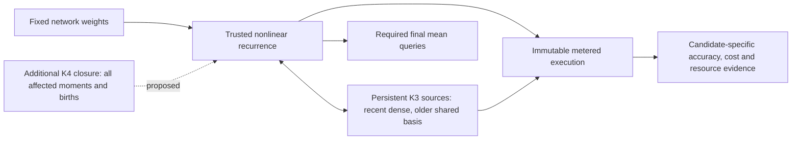

# Winning strategy assessment — 14 September 2026

**Private research and planning document.** Requested multi-agent review of the repository, live competition in Samuel's Chrome, published implementations and primary literature. This review ran no experiment, accessed no protected labels, changed no estimator or validation instrument, and made no submission or designation. Recommendations below are not preregistered experiments or approved write-up claims.

## Decision

**Keep the cumulant architecture family; change the execution plan from repeated arithmetic savings to a coordinated cost-and-accuracy program.** The repository has identified a credible destination, but has not implemented or validated a winning architecture. F21 proves an algebraic cost improvement. It does not prove the full-rank compact bridge, lossy compression, or an inexpensive richer fourth-order correction.

The recommended destination is a faithful nonlinear recurrence with persistent third-order history, compact storage/transport of older history, a consistently derived additional fourth-order correction, and a legal metered backend. These are separate pieces with separate acceptance tests. The first action is the already identified tiny B4 precision-versus-recurrence discriminator. The first research milestone is a complete cheaper implementation of the same recurrence. The next is a real accuracy improvement whose additional cost is included in the score.

This is the strongest evidence-backed path found, **not a prediction that it will win**. The leader's source is unavailable on the inspected submission pages. No paper establishes a cheap exact solution at the challenge shape. The inexpensive fourth-order extension still needs a concrete derivation, and compression may fail its complete cost test. Time-box these uncertainties rather than treating the architecture diagram as a result.

## Competition target and our actual position

The task is to predict each neuron's average post-ReLU activation when a fixed random network receives standard Gaussian inputs. Phase 2 uses width 1024 and depth 16. It is an expectation over inputs for each particular set of weights; results that average over randomly drawn weights solve a different problem.

For a successful network, the score is `MSE_i * max(0.1, FLOPs_i / 2**41)`, averaged arithmetically across networks. Lower is better. Residual time does not enter that multiplier at lambda zero; exceeding its 0.4-second cap fails the network. Wall time is capped at 120 seconds and installed process memory at 8,192 MiB. Final prize ranking comes from fresh private reruns of up to two designated entries, with a default selection rule if none are nominated. Public rank is useful context, not the statistical objective. [Rules v14](https://www.aicrowd.com/challenges/arc-white-box-estimation-challenge-2026/challenge_rules).

Live Chrome observations on September 14, approximately 07:20–07:40 UTC:

| Phase-2 entry | Adjusted score | Raw final MSE | Position |
|---|---:|---:|---|
| suliman_tadros #330876 | 2.540e-9 on detail page | 1.891e-8 | 1 |
| marius_binner | 2.60e-9 | 1.70e-8 | 2 |
| J2W | 2.70e-9 | 1.93e-8 | 3 |
| Puffi | 2.80e-9 | 1.94e-8 | 4 |
| 504aldo | 5.40e-9 | 2.13e-8 | tied 26 |
| Our F21 #330950 | 1.5957295444e-8 | 3.7794361702e-8 | tied 58 / 156 |

**The official truth-noise floor for every public MSE in this table is unavailable.** Values other than our archived score are visible-page precision. The board rounds the leader to 2.50e-9; its detail and Insights show 2.540e-9. Our gap to that better-resolved target is about **6.28x**. The leader uses about 13.43% of budget and has roughly half our raw error. Its varying per-network costs establish varying executed work, not a particular adaptive algorithm. [Phase-2 board](https://www.aicrowd.com/challenges/arc-white-box-estimation-challenge-2026/leaderboards?round=phase-2), [leader detail](https://www.aicrowd.com/challenges/arc-white-box-estimation-challenge-2026/submissions/330876), [F21 detail](https://www.aicrowd.com/challenges/arc-white-box-estimation-challenge-2026/submissions/330950).

The Phase-1 board was also reviewed: ednacob leads its completed public board at 1.84e-8 and our account is 103rd of 312. Changed shapes and accounting prevent a direct comparison with Phase 2. The relevant deadlines are October 2 for registration/team freeze, October 17 at 23:59 UTC for submissions, and October 24 for the contribution write-up. The generic October 31 competition-period text does not extend the submission deadline. [Phase-1 board](https://www.aicrowd.com/challenges/arc-white-box-estimation-challenge-2026/leaderboards?round=phase-1), [Rules](https://www.aicrowd.com/challenges/arc-white-box-estimation-challenge-2026/challenge_rules).

### Why cost savings alone cannot finish the job

At unchanged public raw error, F21 would score **3.7794e-9 even at the minimum 0.1 multiplier**, above 2.540e-9. It needs at least **32.79% lower raw error at that floor**. This is conditional score algebra using a dated target, not a new accuracy measurement.

| Constant cost multiplier | Largest raw error tying 2.540e-9 | Reduction from current public F21 raw error |
|---:|---:|---:|
| 0.42221, approximately F21 | 6.016e-9 | 84.1% |
| 0.20 | 1.270e-8 | 66.4% |
| 0.15 | 1.693e-8 | 55.2% |
| 0.10 | 2.540e-8 | 32.79% |

A joint planning target such as raw error `1.9e-8` at multiplier `0.12` gives `2.28e-9`, below the dated leader. Neither component, nor their combination, has been demonstrated locally. For adaptive costs, evaluate the mean of per-network products; multiplying mean error by mean cost is not valid in general. Reaching multiplier 0.20 is an intermediate engineering milestone, not a winning target at current accuracy.

## What the repository has actually established

The strongest frozen method is `estimator_k3_strassen_L4_f21.py`, associated with #330950. Root `estimator.py` remains the historical v2.6.1 Gaussian/K2 path at width1024. A default command against that file does not exercise the competitive candidate. This is a candidate-identity problem to make explicit, not permission to overwrite either archive.

F21 preserves the selected SIMPLE factored cumulant recurrence, all retained third-order source ages, scalar fourth-order information, nonlinear Wick/centering computations and covariance feedback. It uses float32 hot state, batched Strassen L4, and a fused D21 contraction that removes one matrix product. Its count falls from L4's 1,068,245,507,686 to **928,457,637,478 FLOPs**, a **13.08574% reduction**. Exact representation of this selected approximate recurrence is not exact integration of the network or inclusion of every higher-order term. See the [source-level architecture audit](research/2026-09-14_architecture_audit.md).

The fresh P10 paired 128-network result supports that intervention: arithmetic score gain **1.150566x**, all 128 pairs favoring F21, and 95% paired t interval on L4-minus-F21 score `[2.4582563842e-9, 2.5842673161e-9]`. Raw errors remain essentially equal, about `4.1821e-8`, beside midpoint truth-noise floor `2.2363658e-9`. The public descriptive paired gain is **1.150559x**. This is strong evidence that the cost model predicts this particular algebraic change. [P10 artifact](../experiments/2026-09-13_p10/decide_P10.json).

The graded report records **100/100 complete, no failure flags**, worst residual **0.15623225 s** (2.56x headroom) and worst predict wall **93.1597153 s** (1.29x headroom). Every count matches the f64-readonly candidate model; this path needs no extra server offset. A Linux capped candidate test supplies real memory evidence at about 5,381.7 MiB peak virtual size. Native Windows accounting alone would not. [Official graded report](../experiments/run_reports/f21_diagnostic_330950_graded_report.json), [validation audit](research/2026-09-14_validation_audit.md).

Two qualifications remain. First, the local official capped mini failed 100/100 on residual and the Full certificate refused. The separately authorized one-time server diagnostic does not turn those into local passes or waive future gates. Second, source and package hashes are verified locally, but the server metadata exposes no uploaded archive hash; exact server-byte attribution remains provisional despite the matching cost fingerprint. Preserve both facts in the release record.

## Architecture: identified, but not yet followed through

The right separation is between **what mathematical recurrence we approximate**, **how its state is represented**, and **how its operations execute**. Earlier failed experiments sometimes changed more than one at once. The original compact template's off arm did not implement the working recurrence, so it could not establish whether faithful compression was viable.

**Trusted operator.** Freeze the working Wick term table, normalization, raw-to-centered conversions, scalar K4, covariance feedback, source births, and output readout. An independent dense tiny interpreter supplies a diagnostic reference. Do not require an exact probability-law representation as a prerequisite for testing an explicitly approximate closure.

**Persistent representation.** Keep recent source ages dense and represent older ages in a transported shared basis with explicitly retained residual factors. Keep every age. First reproduce the operator at full rank; only then lower a single rank schedule. Compressing carried legs and compressing the residual are separate approximations. A faithful starting bridge is `A=A_L, P=M, w2=w2b, s=e=0, Z=A_D, L=I`; no extra K4 field is needed to reproduce current F21/L2 semantics. [Architecture audit](research/2026-09-14_architecture_audit.md).

**Accuracy extension.** Add a declared approximation to missing fourth-order structure only when all affected consumers and third-order births follow from the same definition, with overlap with current scalar K4 removed. Extra terms in one moment calculation alone are not a coherent extension. An arbitrary K4 tensor core is not itself a covariance matrix; projecting it to PSD has no automatic justification.

**Execution.** Preserve F21's proven algebraic savings when compatible, but price transport, reconstruction, basis joins/rotation, compression, centering and readout together. A thin stored state can still require expensive dense reconstructions. Include live temporaries, scalar synchronizations, payload shapes and wall uncertainty. More Strassen recursion is not automatically faster or safer merely because it counts fewer FLOPs.

### The first unresolved dependency

Existing B4 failed **85 of 841** checks on a fixed width8/depth6 fixture at tolerance `1e-5`; its first failing checkpoint is `wick.(4,1)` at zero-based layer index3. The compared reference uses float32 while the compact interpretation uses float64 on the same float32-quantized weights. This leaves precision and recurrence confounded.

The cheapest next discriminator is the frozen reference evaluated in float64 versus the full-rank interpreter in float64, with identical weights and semantic choices, logging the first differing operands. A pass supports the precision explanation; it does not certify the actual float32 backend. A failure demands localization before compression. Preserve the original failed gate and record the new instrument comparison separately. This needs no new challenge labels. [Current packet](STRATEGIST_PACKET_2026-09-14.md).

## Literature and public experiments: what transfers

The directly relevant ARC paper studies fixed-network expectations using cumulants and Hermite expansions. Its efficiency theorem concerns fixed-depth polynomial activations; ReLU evidence is empirical, and its final linear readout must be aligned with the challenge's post-ReLU output. The latest observed paper remains v2, May 14, and the reference repository pin remains August 4. This supports the family, not a rank/cost guarantee for our network. [Wu et al., paper](https://arxiv.org/html/2605.05179v2), [pinned reference](https://github.com/alignment-research-center/mlp_cumulant_propagation/commit/93d091a4c26c042bfffa28f2e76a81bc0aba94bb).

The upstream correction distinguishes factorable AUGMENT from unrestricted augmented terms. Our T1's **8n factorable AUGMENT** improves cross-estimated MSE from `4.00468513e-8` to `1.91232321e-8` over 24 networks, beside per-half truth floor `1.1552e-9`. The paired difference interval is `[1.9441e-8, 2.2406e-8]`. This is strong evidence of accuracy headroom in a coupled richer recurrence; it neither isolates a matrix-K4 cause nor establishes an affordable full-K4 solver. [T1 artifact](../experiments/2026-09-10_slice5/t1_augment_lite_v2.json), [upstream correction](https://github.com/alignment-research-center/mlp_cumulant_propagation/commit/56f736a7e74c60d9714fa06bd5cb6bf48217a6d8).

504aldo's inspectable implementation and author ablations motivate persistent shared-basis K3 and consistent regenerated K4 use plus K3 feed. Its reported raw errors have unavailable reference-noise floors and reused public/development panels; they are external hypothesis support, not our decision evidence. Tiny off-shape tests disable its target-shape K4 branch and cannot validate that closure. The September 14 reply reports another 7–22% cost improvement by others and sponsor permission for metered Strassen-Winograd without a recursion limit; the original sponsor correspondence was not inspected. Neither that claim nor similar rounded board scores identifies the leader's source. [Pinned ablations](https://github.com/504aldo/whest-p2-cumulant-k3/blob/18c17e2d7a9aeacd399cfc2c6b571e4e16dbfb45/docs/ablation_table.md), [new reply](https://discourse.aicrowd.com/t/18218/3).

The most promising transfers beyond these implementations are:

| Mechanism | Evidence and limitation | Smallest useful test |
|---|---|---|
| Output-sensitive shared-basis compression | Goal-oriented tensor reduction preserves consumed observables; no challenge-specific rank theorem | Equal-rank tiny bases compared on D3/D21 and full final-mean perturbations, including signed cancellation |
| Coherent approximate extra K4 | Coupled local AUGMENT gain plus external use-and-feed ablations; cheap stable formula unestablished | Independent dense definition of all extra moments/births, no double counting, forced target branch, known negative-variance fixture |
| Polynomial feature sketch of old-source quadratic queries | TensorSketch and low-rank elementwise-function sketches provide an algebraic primitive; rotation, cancellation and nonlinear feedback are unresolved | Exact unsketched tensor identity, then sketch variance/rotation fixtures and complete supported-operation cost |

The 2025 goal-oriented tensor paper supports selecting a basis by the quantities the solver consumes rather than just stored tensor energy. A proposed diagnostic combines scaled D3/D21 error with downstream output sensitivity. A single scalar adjoint cannot certify MSE over 1024 means, and sensitivity construction must save more than it costs. [Dunlavy et al.](https://arxiv.org/html/2508.11139v1).

For the sketch hypothesis, if old-source legs share `Q`, a quadratic slice has exact form `D = Phi2(Q) B Q.T`, with conceptual `B = sum_a (F_a tensor H_a) K_a.T`. Approximate both quadratic features with the same sketch without materializing the cubic core. A fixed sketch does not commute with arbitrary basis rotation; rebuild from retained factors and count that work. Signed cancellations and nonlinear feedback can erase the apparent advantage. The companion report gives the precise identity, resource model and falsifiers. These concepts were already suggested in the September 10 review; no originality or winning result is claimed here. [Corrected TensorSketch](https://arxiv.org/abs/2505.08146v2), [Han, Avron and Shin](https://proceedings.mlr.press/v119/han20a.html), [full research derivation](research/2026-09-14_frontier_research.md).

Recent finite-width NTK diagrams concern weight-ensemble observables, not this fixed-network expectation. Recent importance sampling/preintegration offers a mechanism only if a cheap effective low-dimensional conditional integral exists. Exact geometric ReLU integration in two dimensions does not establish scalability to 1024 inputs. None supplies a directly transferable winning solver. Conversely, an older repository statement that a QMC upper bound proves Sobol can only improve constants is too strong: an upper error guarantee is not an impossibility theorem. Correct that theoretical interpretation without reopening measured closed lanes automatically. [Finite-width diagrams](https://arxiv.org/abs/2508.11522), [QMC 2026](https://arxiv.org/html/2603.01763v2), [geometric integration](https://arxiv.org/abs/2509.15538), [QMC boundary theory](https://arxiv.org/abs/1702.03361).

## Can we accurately test offline?

**We have a credible mathematical and counted-cost evaluator, not a complete private-service replica.** Keep it and close specific gaps. F21's almost identical predicted and observed paired gains are the best evidence of its usefulness. Its fresh absolute forecast is about 4.94% higher than its public score on different networks; that does not imply an error to fit away.

| Aspect | Assessment | Required action |
|---|---|---|
| Network mint, shape, score and failures | Strong existing alignment with installed official stack | Preserve distribution/seed provenance and per-network arithmetic |
| Paired decisions and label noise | Strong tier separation and arithmetic intervals | Plan precision around the isolated effect; retain replica noise and all failures |
| FLOPs | Exact current F21 graded count under candidate-specific representation | Check each new primitive/dtype/output path; no universal added offset |
| Memory | Real Linux candidate cap evidence exists | Recheck changed lifetimes; separate process limit from worker reservation |
| Residual/wall | Local official residual is a demonstrated false negative for F21 | Keep LOCAL refusal separate from server observations and forecast uncertainty |
| Numerical sensitivity | Latest certificate used stale error scale | Declare candidate scale before checks; use existing tighten-only mechanism |
| Truth arithmetic | Sampling-noise checks do not exclude shared numerical bias | Pin production GPU math mode and record runtime; test actual-shape shared-input parity |
| Durable results | Completed rows can still be lost before final write | Atomic per-row journal and complete/failed/interrupted manifest |
| Candidate identity | Root default is historical | Explicit source-bound candidate release record |

Three concrete defects deserve short, targeted instrument work. `cert_F21_full.json` left `ARC_WHEST_RAW_MSE` unset, so its permutation threshold uses `1.4e-8`, roughly one third of current raw F21 error rather than the intended 1%. This is a loose coverage threshold, not evidence of that much actual drift. `f21_score.py` writes durable results only after its arms finish, so interruption can still destroy single-use evidence. `p2_truth.py` does not pin and record the production TF32/matmul mode; the older parity script uses a different function and defaults to Phase-1 shape. Replica agreement cannot rule out a shared arithmetic bias. [Detailed audit and acceptance criteria](research/2026-09-14_validation_audit.md).

The corrected forum residual thread identifies scalar conversions that flush pending remote operations: the author reports removing 166 conversions eliminated failures at approximately the same call count. This is participant evidence, but it directly cautions against a universal microseconds-per-operation model. Record synchronization points, payloads and kernel structure. The later large-batch crash report remains unresolved. [Correction](https://discourse.aicrowd.com/t/18202/4), [open issue](https://discourse.aicrowd.com/t/18202/5).

Reliability is central to winning. Existing P10 zero-output error is about 0.909, so a representative failure among 100 networks would contribute roughly 0.00909 to the mean score, overwhelming successful scores near 1e-8. Zero failures in 100 is useful, but does not statistically prove an essentially zero failure rate. Resource margins, branch coverage, immutable-array contracts and repeated-process lifetime checks must carry that argument.

## Execution decision and boundaries

Use the [implementation plan](IMPLEMENTATION_PLAN_2026-09-14.md): bounded instrument repair and B4 parity first; one faithful all-age compression intervention next; a separately derived accuracy extension; then combined fresh paired evidence and candidate-specific release checks. Reserve output-sensitive compression and sketches for short feasibility tests, not an autonomous search loop. Preserve F21 and L2 as validated comparison points throughout.

Public-resource permission and the rules' source-authenticity restriction remain difficult to reconcile for a particular participant-derived implementation. A successful grade or MIT license does not by itself establish prize eligibility. The existing [eligibility review](ELIGIBILITY_REVIEW_2026-09-12.md) contains an unsent clarification. Resolve that separate winning prerequisite before relying on a derivative for prize selection; no external message was sent by this review.

Research coverage: three specialist agents separately inspected architecture, validation and literature; a fresh-context Skeptic checked raw exposed result artifacts and this synthesis. Chrome review covered all requested pages, current and Phase-1 boards, own/latest and leader details, all 29 discussion titles and seven relevant thread bodies. It did not inspect private competitor source, every attachment, or the linked talks. Primary literature, source pins and detailed caveats are in the [frontier report](research/2026-09-14_frontier_research.md); live observations are in the [competition review](research/2026-09-14_competition_review.md). The separate [Skeptic verdict](research/2026-09-14_research_skeptic.md) governs acceptance of this research synthesis, not promotion of an unbuilt candidate.
