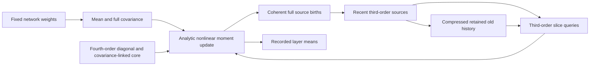

# Strategy and implementation plan — 16 September 2026

Prepared from three parallel repository/literature audits, a live Chrome competition review, and an independent raw-source Skeptic. This is a research assessment and implementation proposal, not a measured new candidate, promotion, submission authorization, or contribution-prize claim. Frozen estimators and instruments are unchanged. No new experiment, truth generation, seed claim, or vault touch was performed.

## Decision

**Keep the cumulant-propagation family. Repair its incomplete fourth-order feedback, then reduce the cost of retained third-order history. Do not restart with sampling or Gaussian-only closure.** The repository has identified the right broad direction and has demonstrated real progress, but it has not yet identified and validated a winning representation.

v31's latest graded result is 8.7520303e-9, 1.8233x better than F21 on the paired public graded rows. Live rank is 58/165. The current leader's detailed page reports 2.448e-9, raw 1.678e-8 and 14.59% compute. Our raw is 2.9074e-8 at 30.1025% compute. The descriptive remaining gap is about **3.575x = 1.733x accuracy x 2.063x compute**. Organizer truth-noise floors are unavailable for these graded MSEs.

Our best new finding is a concrete likely omission in the birth of the third-order state. v31 carries fourth-order corrections into repeated-index slices but lacks the explicit all-distinct feed carried by the public reference implementation. This is a source-level structural distinction; its score effect is not yet measured. The independent Skeptic was given raw sources and contracts, not the audit narratives, to challenge this finding.

The current Slice 7 plan has the right near-term priorities, but two central claims need qualification: leaderboard telemetry does not reveal the leaders' algorithm, and halving a basis rank does not demonstrate that a merged tensor is affordable. A proposed 0.20-budget method at 2e-8 raw would score 4e-9. That would be a major improvement, but it would not win today's board.

## What a competitive architecture would contain

The key is preserving the dependence between neurons as it moves through the network. The nonlinear update reads small slices of a larger state, but carrying only those slices loses information that becomes important after the next weight matrix mixes neurons.

The practical target has these components:

1. Dense mean/covariance propagation and the working selected Wick/cumulant recurrence.
2. Recent third-order sources represented accurately, with v31's algebraic regrouping and controlled low-rank residual.
3. A fourth-order diagonal plus covariance-linked off-diagonal approximation, consumed consistently in both moments and **full** third-order births.
4. Thin feedback from the third-order slices into newborn sources, subject to an isolated benefit/cost check.
5. Old history retained in a shared or otherwise compact representation selected for its effect on future mean/covariance/birth updates. This remains the unproven frontier component.
6. Final-layer pruning, supported float32 operations, batched matrix families, and reusable scratch buffers. Every online basis selection, contraction, synchronization and allocation belongs in the evidence.

v31 implements parts 1–3, with the feed gap described below, and some of part 6. It still carries all old dense sources. The intended architecture is present in the planning documents, but not yet fully implemented. `estimator.py` is an older shipped baseline; the latest graded bytes are `estimator_k3_v31.py`, SHA `6dde5fd43ad41e8ec7199b742dd554d22d506c9cf85a532027e86a590d0a787c`. That distinction must be machine-readable to avoid validating the wrong file.

## The next accuracy experiment should answer a specific question

The existing `feed_already_present.md` correctly shows κ4 entering `K[(3,)]` and `K[(2,1)]`. It does not establish that the all-distinct `(1,1,1)` tensor receives the same feed. It also incorrectly describes the public implementation as not using the term table: v17 does use such a table and adds a separate full feed.

At fixed incoming state, v31's κ4 change enters a repeated-support completion with identity legs. That completion has zero entries when all three indices differ. The public implementation's off-diagonal hub has generally nonzero all-distinct entries. It subtracts the hub's repeated slices before constructing the residual, avoiding double counting. A later dense transport mixes the distinction into the slices used for mean estimation.

The immediate discriminator is therefore **a tiny full-tensor birth comparison followed by one transport**, with incoming mean, covariance, coefficients and λ held equal. Compare distinct and repeated entries separately. Ordinary agreement of repeated slices at birth cannot pass this test. Do not simply paste in the entire feed: add the independently derived missing component and subtract the repeated content already present.

This refines D2/D3 rather than reopening a discarded method. D1's λ-profile diagnostic remains useful, but v31 already contains both subtraction and addition in the proposed dG transport. The source does not support repeatedly guessing that this term was omitted. Different full trajectories alone also do not identify a bug: compare identical saved incoming states first.

Sources and exact source anchors: [architecture audit](2026-09-16_architecture_audit.md). No improvement factor is established for this correction yet.

## Score targets distinguish a major jump from winning

For constant compute fraction q, adjusted score is raw MSE times max(0.1,q). These are planning calculations, not predicted results or experiment gates:

| Candidate scenario | Raw MSE | q | Adjusted score | Meaning against today's board |
|---|---:|---:|---:|---|
| Current v31 | 2.9074e-8 | 0.3010 | 8.752e-9 | Graded |
| Hypothetical 1.5x accuracy gain only | 1.9383e-8 | 0.3010 | 5.835e-9 | Useful; still outside current top ten |
| Same accuracy, compressed history | 1.9383e-8 | 0.20 | 3.877e-9 | More than 2x score improvement; around today's top-ten boundary |
| Stronger efficiency | 1.90e-8 | 0.12 | 2.28e-9 | Below today's leader, if reproduced safely |
| Margin target | 2.00e-8 | 0.10 | 2.00e-9 | Research target with headroom against today's score |

At v31's present raw error, even the 0.1 scoring floor yields 2.9074e-9, so cost alone cannot win. At current cost, tying the leader would require roughly 8.13e-9 raw, far beyond any improvement established here. Both axes must move. For adaptive work, average each network's error-times-cost product; multiplying two averages is incorrect.

Recommend treating **about 4.0–4.4e-9 or better** as the desired next major performance release, combining separately verified gains where compatible. Treat **about 2.0–2.2e-9** as a moving research objective, not a promise. Keep mathematically useful intermediate candidates and their receipts; a materially different runtime structure may still need a specifically justified server canary. Ten available daily slots are a ceiling, not a reason to spend them without a question.

## Implementation sequence

Each row produces a concrete artifact and has a stopping condition. These are proposed amendments to execution planning, not authorization to run strategic measurements without the required prediction/registration. Existing thresholds remain authoritative until a pre-data contract amends them.

| Order and time budget | Work | Deliverable and validation | Stop or decision |
|---|---|---|---|
| 0 — half day | Repair immediate diagnostic invocation and evidence-loss defects | Canonical accuracy wrapper disables only the local residual cap; raw stdout/stderr always retained; report identifies candidate, runner, package and dataset; fixture tests for residual-only failure and partial output | No broad harness rewrite; finish bounded defects and return to estimator work |
| 1 — 1–2 days | Complete D1–D3 with the full distinct-index feed discriminator | Tiny dense f64 birth/transport oracle; separate new candidate; one shared-state trace; isolated target-shape ledger; paired P11 screen against frozen v31 | If feed equality holds, reject this diagnosis. If algebra differs but score does not improve, do not promote it on theory alone. Existing slice gate: at least 1.5x raw improvement, cost within 0.5%, paired interval excluding zero |
| 2 — 1 day | Thin D21 birth feedback, after corrected feed is settled | New separately attributable candidate and tiny recurrence oracle; paired screen | Existing P3 gate: at least 1.06x raw, no more than 1% extra cost. Count interactions with the feed; don't multiply independent gains as a forecast |
| 3 — 1–2 days | Exact cost reductions: final variance-only readout, pooled scratch, next Strassen level, block-symmetric covariance where supported | Algebra/parity tests, real live-shape meter, synchronization count, Linux lifecycle memory | Existing P4 target <=0.27B at raw parity, <=20k operations; timing is separately forecast and then calibrated. Reject extra recursion if wall/residual/memory erases benefit |
| 4 — at most 2 days before a go/no-go | Repair N1: relevance validity plus full cost prototype | Define the perturbation and output norm; compare cheap mean-path proxy with full remaining recurrence; implement one complete old-history join/transport/query cycle | Do not run a large rank sweep unless the proposed online cycle can plausibly beat the current ledger. Failing a proxy rejects that proxy, not the entire family |
| 5 — 3–5 days if stage 4 passes | Output-aware old-history reduction, with forward-energy control and explicit rank/cost curve | Frozen policies, paired DESIGN results, end-to-end metering; r=128–150 included as economically interesting cases alongside existing rank grid | Initial <=0.20B and <=5% raw loss is an intermediate gate. Continue toward roughly 0.10–0.12B only if actual accuracy permits. No rank-only promotion |
| 6 — fallback or parallel mathematical work | Shared old-source basis without dense merging; conditional implicit query/sum sketch | Keep a safe price/accuracy frontier and bounded proof of update/join/readout | Do not force a costly dense core merely because weighted rank improves. Do not revive failed source deletion or slice-only memoryless closure |
| Release — once frozen bundle is materially better | One candidate-specific release receipt and package | Required affected checks, immutable weights/setup, shape fallback, determinism, full mini confirmation, exact counted cost, matched Linux memory, source/package hashes | Present score/noise/uncertainty and runtime risk for Samuel's per-submission approval. Agents never designate |

The sequence preserves an improving fallback while reserving time for the actual frontier question. By early October, select the best supported accuracy/cost frontier and spend the remaining window on fresh-network robustness and deployment margins. Do not turn October 16 into the first full lifecycle run of a novel representation. Contribution claims can be recorded alongside experiments; publication is a separate reviewed deliverable.

## Two research directions worth funding, with falsifiers

**A. Compression based on the full moment recurrence.** Preserve directions that affect later D3, D21, covariance and new births, rather than merely high factor energy or the final mean-gate Jacobian. Quantity-of-interest tensor approximation and balanced reduction supply precedents, but no paper proves the needed challenge rank. On tiny saved states, test whether a candidate relevance metric predicts actual final-vector changes under signed old-state perturbations. Specify a positive-semidefinite objective/generalized problem; a naive product of two Gram matrices is not ordinary symmetric PCA. Kill a proxy that discards harmful covariance/birth directions, then assess whether a corrected cheap proxy remains affordable online.

**B. Implicit summation and compressed quadratic queries.** Instead of constructing an expanding dense old tensor or reconstructing every old source, test whether the aggregate can answer `D3/D21` queries through structured quadratic features. The March 2026 Tucker-sum paper offers an implementation route for compact joins; TensorSketch literature offers query approximations. Neither demonstrates our required accuracy. The first prototype must handle a source join, a basis change, signed cancellations, queries, and subsequent nonlinear feedback. Kill it before a truth run if rotation/reconstruction costs erase savings or the required sketch becomes too wide.

These are potentially original challenge-specific applications, not claims of global novelty. Earlier repo research already proposed output-sensitive bases and query sketches. The contribution would be a new correct construction with a measured accuracy/cost law, not a new name for those proposals.

Dense Tucker needs particular caution: cubic storage is not cubic total computation. A generic three-mode core rotation costs O(r^4); repeated-index readout costs O(n r^3+n^2 r). Transporting a physical basis can defer rotations, but joins and rebasing still require a specified schedule. All of this must pass the official meter. N1's current rank-halving criterion omits this economic test.

Primary sources and applicability limits are in the [literature review](2026-09-16_literature_review.md), including [Wu et al.](https://arxiv.org/html/2605.05179v2), [quantity-of-interest tensor decomposition](https://arxiv.org/html/2508.11139v1), and [implicit Tucker sums](https://arxiv.org/html/2603.13532v1).

## Validation verdict: preserve the mathematics; simplify orchestration

The core is credible: canonical networks, independent truth replicas, setup-aware execution, immutable float64 input weights, official metering, per-network arithmetic score aggregation, and a real Linux cap. Today's forecast 8.7133e-9 versus graded 8.7520e-9 is a useful success. It does **not** establish universal half-percent accuracy or a calibrated prediction interval for hidden networks.

Verified defects requiring bounded fixes:

- Default candidate smoke still enables the local residual cap. It can zero the prediction before later advisory wording matters. Optional soak and preflight retain related traps.
- `predict_public.py` still uses local worst wall times 1.60, disproved by the standalone v31 run. The temporary 1.9-times-standalone-median rule is also a family-specific forecast, not a safety proof.
- Its FLOP band still uses offsets 0 and 2^24. Both stored subprocess reports differ from graded reports by 2^25; the grader-twin path already matches and must not receive an extra offset.
- Certification compares Git status text instead of dependency content: unrelated edits can invalidate good work, while further edits to an already-dirty instrument can escape detection.
- Projected reports are not sufficiently bound to the source/dataset/runtime that generated them, and the displayed interval omits hidden-suite transfer uncertainty.
- Operation-count summaries use averages. Adaptive-rank candidates need the worst per-network count and synchronization behavior against per-network cliffs; a safe mean is insufficient.
- The Linux memory check is real, but its Python 3.12.3/NumPy 2.4.6 differs from the graded Python 3.10.21/NumPy 2.2.6. Match versions for final deployment evidence.

Full evidence and line references are in the [validation audit](2026-09-16_validation_audit.md). The lightweight scorer and projector suites passed 134/134 and 39/39. Passing tests did not detect the stale empirical timing assumption because the tests assert that assumption; add regression fixtures from real reports.

Offline parity should have four explicit verdicts: **mathematical output/cost**, **distributional generalization**, **deployment memory/lifecycle**, and **server timing forecast**. Do not call a locally cap-disabled accuracy run a proof of server residual compliance. Do not call a Windows memory inventory an enforced 8-GB pass. Match participant/backend roles in Linux as far as practical and report remaining hardware differences. Occasional approved canaries remain necessary for new runtime structures.

P11's recorded truth noise is 4.76e-9, material relative to a hoped-for 2e-8 raw error. Preserve observed and noise-aware results and the independent replicas. Shared truth noise cancels in an equal-cost paired difference, but not when cost multipliers differ. Use the canonical scorer's correction. A repeated DESIGN screen is not fresh independent confirmation; fitted constants need a frozen fresh DECIDE check under the operative policy. The public mini remains confirmation only. Do not increase Monte Carlo precision blindly: first ask whether the paired interval can resolve the intended effect.

## Make iteration faster with one small execution layer

Use existing `evidence_journal.py` rather than adding an experiment platform. A candidate receipt binds candidate/instrument/package hashes, data/truth identity, seed/setup, weight mode, caps, numerical settings, meter path and completed checks.

| Path | Run on each change | Do not repeat without a reason |
|---|---|---|
| Algebra/debug | Contract, tiny oracle, affected invariants; one live-shape cost run for a changed graph | Full mini, whole-repo certification, unchanged instrument self-tests |
| DESIGN | Frozen paired candidate/control rows, truth-noise-aware score and cost | Valid baseline predictions or truth generation with identical identity keys |
| Fresh decision | Preregistered frozen candidate and one held-out read where required | Repeated tuning on the decision block |
| Release | Missing/stale candidate-specific checks, one full mini, deployment memory and package identity | Subset smoke already covered by a validated full-run receipt; unrelated old K2 evidence |

A report should say which evidence was reused and why it is still valid. Never reuse candidate execution across changed bytes just because the filename is the same. Persist raw output at launch and rows as completed; a process crash must leave a usable diagnostic record. Reuse memory certificates only for matching source/dependency/configuration, or a separately justified lifetime-equivalence policy.

Small organization changes suffice: a candidate-role manifest, one active plan pointer, scoped receipts, and an explicit separation between experimental reference math, representation backend, and the single-file export. Avoid moving the historical experiment tree or refactoring the whole estimator before the feed diagnosis.

The September 14/16 handoffs record Samuel's process simplifications, while AGENTS/GAME_PLAN still contain older blanket language and stale active-plan pointers. Consolidate this policy once through a documented change; do not rediscover or reinterpret it for every run. This review does not silently weaken any currently binding gate.

Every heavy run still needs the required optimization review and workerq reservation. Reuse valid truth/baselines, stream networks instead of retaining duplicate copies, choose worker/prefetch counts deliberately, checkpoint complete rows, and declare conservative measured memory. Prefer the 16–24 GiB envelope where appropriate, not by underdeclaring. GPU resources accelerate local truth/reference work, not the CPU-only submitted algorithm.

## What this review establishes

We have a defensible route to a major next improvement, with a specific accuracy discrepancy and measurable cost work. We do not yet have evidence of a method that will win. The current plan should continue with the full-feed test and bounded infrastructure repairs, then earn its compression claims through a complete update-and-query prototype. No submission or designation was made by this review.

Supporting records: [competition and discussions](2026-09-16_competition_audit.md), [architecture](2026-09-16_architecture_audit.md), [validation](2026-09-16_validation_audit.md), [literature](2026-09-16_literature_review.md).

Independent [Skeptic verdict](2026-09-16_independent_skeptic.md): **PROVISIONAL**. The raw-source review corroborated the distinct-index feed gap and the N1/validation deficiencies. It did not establish the missing feed's score benefit or rule out affordable merging at sufficiently low rank. Its cheapest recommendation is the label-free birth-and-transport identity test before spending P11 accuracy work.
